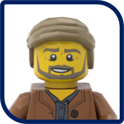
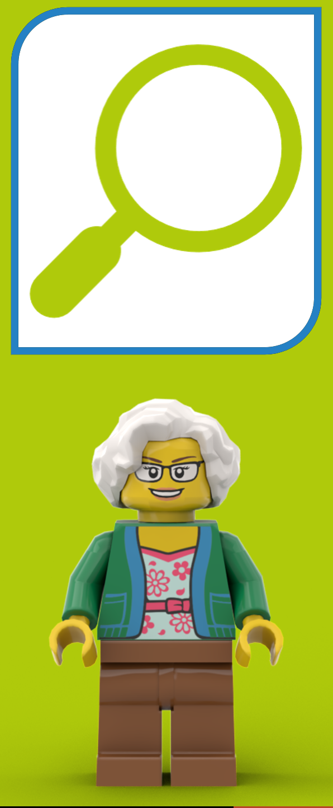
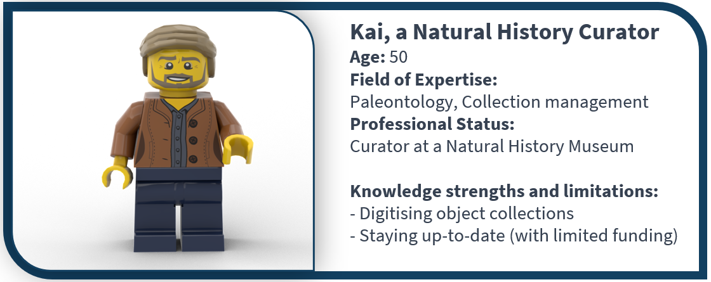
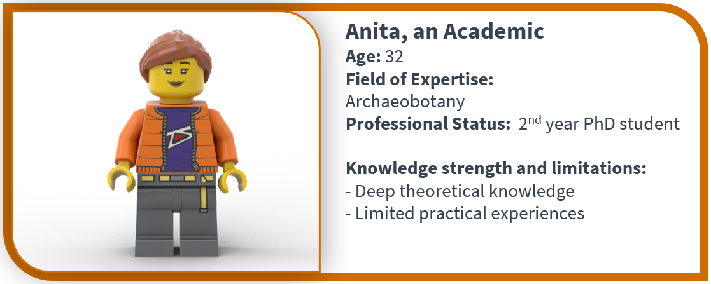
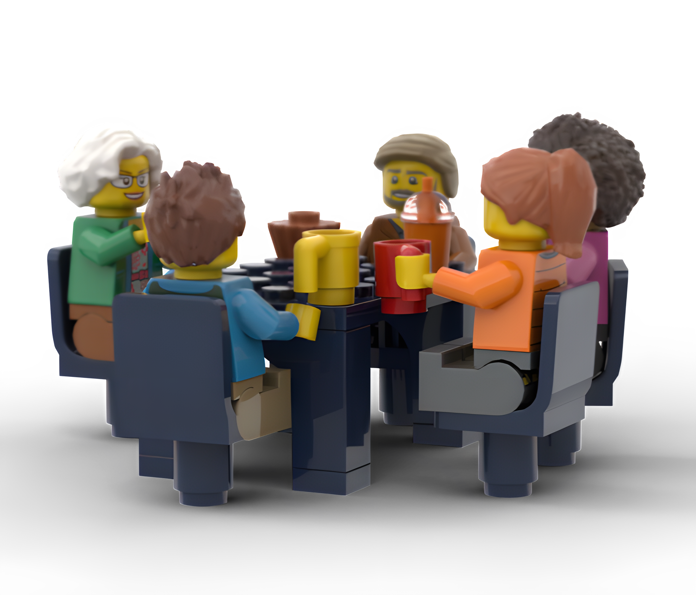
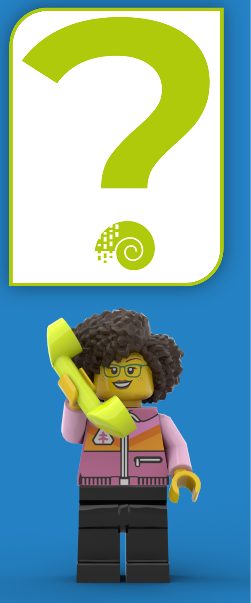

<!--
author:   Asta von Schröder
author:   Anna Lisa Schwartz
email:    asta.vonschroeder@dainst.de
email:    alschwartz@gfbio.org
version:  0.0.1

language: en

narrator: English Female

comment:  ein Test für WiNoDa Kurslayout

link:     https://cdn.jsdelivr.net/chartist.js/latest/chartist.min.css

link:     https://cdn.jsdelivr.net/gh/spaetzuenderin/WiNoDa_L2.4@438c55d/WiNoDa_LiaScript-Style.css

script:   https://cdn.jsdelivr.net/chartist.js/latest/chartist.min.js


@Anita: <div class="persona persona--anita"><span class="persona__image"></span><div>@0</div></div>

@Dave: <div class="persona persona--dave"><span class="persona__image"></span><div>@0</div></div>

@Kai: <div class="persona persona--kai"><span class="persona__image"></span><div>@0</div></div>

@Susan: <div class="persona persona--susan"><span class="persona__image"></span><div>@0</div></div>

@Winnie: <div class="persona persona--winnie"><span class="persona__image"></span><div>@0</div></div>

@AnitaH: <div class="persona persona--anita"><span class="persona__image"></span><div class="persona__heading">@0</div></div>

@DaveH: <div class="persona persona--dave"><span class="persona__image"></span><div class="persona__heading">@0</div></div>

@KaiH: <div class="persona persona--kai"><span class="persona__image"></span><div class="persona__heading">@0</div></div>

@SusanH: <div class="persona persona--susan"><span class="persona__image"></span><div class="persona__heading">@0</div></div>

@WinnieH: <div class="persona persona--winnie"><span class="persona__image"></span><div  class="persona__heading">@0</div></div>

@Anita_: <div class="persona persona--anita"><span class="persona__image"></span><div>@0</div></div>

@Dave_: <div class="persona persona--dave"><span class="persona__image"></span><div>@0</div></div>

@Kai_: <div class="persona persona--kai"><span class="persona__image"></span><div>@0</div></div>

@Susan_: <div class="persona persona--susan"><span class="persona__image"></span><div>@0</div></div>

@Winnie_: <div class="persona persona--winnie"><span class="persona__image"></span><div>@0</div></div>


@ExampleA
<div class="example">
<div class="example__image">


</div>
<div class="exampleA__text">

@0

</div>
</div>
@end

@ExampleB
<div class="example">
<div class="example__image">



</div>
<div class="exampleB__text">

@0

</div>
</div>
@end

@ExampleC
<div class="example">
<div class="example__image">


</div>
<div class="exampleC__text">

@0

</div>
</div>
@end


-->


# Enrichment & contextualization of object-related collection data

<!--style="color: #124061; font-family: Arial; font-size: 18pt;" -->
__About this course__ 


<!--style="color: #124061; font-family: Arial; font-size: 14pt;" -->
__Course format__ 

Online self-study course

<!--style="color: #124061; font-family: Arial; font-size: 14pt;" -->
__Target group__

Researcher in History of Earth and Humanity, professionals in science collection curation or management, data scientists

<!--style="color: #124061; font-family: Arial; font-size: 14pt;" -->
__Course level 2__ 

Intermediate
The course is aimed at people who are already familiar with basic concepts of research and collection data, especially aspects of data quality, or who are willing to acquire this knowledge in advance.

<!--style="color: #124061; font-family: Arial; font-size: 14pt;" -->
__Short Course description__

This course provides an introduction to the harmonization, validation, enrichment, and contextualization of object and find data. Using practical examples, it shows how semantic enrichment with standard data, taxonomies, and similar tools can be used to obtain structured and linked research data from heterogeneous raw data. The course introduces a variety of open online tools and services and focuses on the benefits of sharing/republishing enriched data.

The course language is English.

## Learning Objectives


__Learning Objective Matrix on the Topic of Research Data Management (RDM)__

The course creators of WiNoDa Knowledge lab used the **Learning Objective Matrix on the Topic of Research Data Management (RDM)** (from here on: LOM-RDM) as a basis the for the creation of OER. Learning objectives from the LOM-RDM can be identified by their unique identfier: Subject-ID_Topic-ID-sequential-number.

---

> Petersen, B., Altemeier, F., Boße, S., Dalby, M., Düvel, N., Engelhardt, C., Fichtner, M., Hastik, C., Haugwitz, J.-M., Jacob, J., Koch, K., Kuntz, A., Manske, A., Mühlichen, A., Murcia Serra, J., Ortmeyer, J., Richter, M., Schranzhofer, H., Slowig, B., … Zollitsch, L. (2025). Learning Objectives Matrix on the Topic of Research Data Management (RDM). Zenodo. [https://doi.org/10.5281/zenodo.15846806](https://doi.org/10.5281/zenodo.15846806)

---

__WiNoDa specific adaptions__

Where necessary and appropriate, the generic learning objectives of the LOM-ROM where **adapted to fit the specific needs of the WiNoDa community,** i.e. researchers, collection managers and other persons working with object-related data from natural science collections and the history of the Earth and humanity. Adapted learning objectives received a new ID.  

New learning objectives have been assigned new IDs following a naming scheme based on the generic LOM-RDM's format, but adding a project identifier at the beginning and enumerating variations of the same with a, b,c at the end like this: WiNoDa_subject-id_topic-id_sequential number-a,b,c.  

For example, if an existing learning objective's wording was adapted: 

- 04\_004\_0861 | Learners are able to name different types of repositories.

became

- **WiNoDa**\_04\_004\_0861**a** | Learners are able to name different types of repositories **and aggregators for archaeological data.**
- **WiNoDa**\_04\_004\_0861**b** | Learners are able to name different types of repositories **and aggregators for biodiversity data.**

For completely new learning objectives within an existing topic, the sequential number was counted up, e.g.

- **WiNoDa**\_03\_003\_0677 | **Learners are able to explain the metadata schema ABCD.**

Thus, the generic LOM-RDM remains a stable reference framework for the creation of disciplinary adaptions.

---

> XXXX hier unsere LZM zitieren.

---


__Learning Objectives for this course__

<!--- **LO-ID | Complete Learning Objective**  --->

**Chapter 1** | **Why should we enrich data?**
- **02\_011\_0412** | Learners are able to explain the term data integration.
- **WiNoDa\_02\_011\_0417a** | Learners are able to explain goals **and benefits** of data integration.
- **01\_001\_0157** | Learners are able to explain the application of open science practices in research.
- **02\_011\_0428** | Learners are able to name challenges in data integration.
- **03\_005\_0703** | Learners are able to explain the term controlled vocabulary.
- **03\_005\_0719** | Learners are able to explain the term norm data.
- **03\_004\_0677** | Learners are able to explain examples for persistent identifiers.
- **02\_011\_0434** | Learners are able to explain data integration with heterogeneous data sources.


**Chapter 2 - Setting** | **How can we enrich data?**
- **WiNoDa\_02\_011\_0424a** | Learners are able to name **open online tools and services for data enrichment**.
- **02\_011\_0426** | Learners are able to name software for data integration.
- **03\_004\_0684** | Learners are able to apply persistent identifiers for referencing.
- **03\_005\_0704** | Learners are able to apply controlled vocabularies to describe resources.
- **03\_005\_0721** | Learners are able to apply norm data.

## Protagonists
Let's introduce our protagonists - their questions and anwsers will guide you through this course:
<div class=persona--kai>
Kai, a collection curator at the Natural History Museum, wants to digitise his collections.
</div>

Dave, a Data Scientist at the museum, lends a lot of support and technical expertise for optimising digital workflows to this project.

Susan, a distinguished entomologist, 

and Anita, a graduate student in archaeobotany,
 work with data from the museum collection. They also support Kai’s digitisation project as taxonomic expert (Susan) and data entry staff (Anita).
The team is backed up by Winnie, who works as a data steward at a data competency centre.


## 1. Data integration, enrichment and contextualisation  

Kai, Susan, Anita, Dave and Winnie are meeting at the museum café.


@Kai(```<p>I’ve been working with our collection data for years, but I keep running into the same problem. We have information about our specimens in our collection database, but there is also relevant information in taxonomic databases, authority files, observation databases and other sources.</p>
<p> The problem is that these sources were created independently and use different structures, terms and identifiers. So although the information belongs together, it is difficult to connect the records and use all these sources together. I keep wondering: how can we bring these different sources together in a meaningful way?</p>```)

@Susan(```<p>I know just what you mean. <br>There are a lot of occurrence observations in the older literature that are recorded simply as place names. Many of these places have since been renamed, or their administrative boundaries have changed. <br>It is very difficult to run large-scale data analyses on such data. There must be a way to connect these old place names to standardised geographical information.</p>```)


@Anita(```
<p>I have a similar problem. <br>In archaeology, findings are often published separately. A digging site can yield lots of different information – pottery shards, remains of buildings, human or animal remains, tools, jewellery and plant remains.</p><p> But publications usually focus on one topic, so the findings are published separately and remain disconnected. It would be really useful to bring all this information together and see it in the context of the same site.</p>```)

@Winnie_(```
<p>
It sounds like you're actually describing three related, but slightly different challenges.
You all want to make existing data more useful by connecting it to other information. There are different ways of doing this, including **integrating, enriching and contextualising data**.
</p>
```)


### Data integration

@KaiH(```What is data integration?```)


@Winnie_(```
<p> Data integration means **bringing data from different sources together so that they can be used and understood in a common context**.
The important point is that integration is not simply putting datasets next to each other or combining them into one spreadsheet. The data need to be connected in a meaningful way.
</p>
<p>
For example, imagine that your museum has a specimen record for:
 **“Aeshna cyanea”**.
 </p>
<p>
Another database may contain information about the species, while an authority or taxonomic service provides a persistent identifier for that species. An observation database may contain records of where and when the species was observed.
By connecting these resources, your original collection record becomes part of a larger network of information.
</p>
```)


### Data enrichment
@SusanH(```What is data enrichment?```)

@Winnie_(```
<p>Data enrichment means **adding information to existing data to make it more complete, precise, or useful**.</p>
<p>The additional information can come from another dataset, a reference source, a controlled vocabulary, a taxonomy, or another external service.<br>
For example, your historical occurrence records may contain only an old place name. By connecting that place name to a standardised geographical name or a persistent identifier, you can add information that makes the record more precise and easier to work with. The original observation is still there, but the record has become more informative and more useful for further analysis.</p>
<p>Data enrichment does not necessarily mean creating a new dataset. Often, a relatively small addition — such as a standardised term, an identifier, a classification or a link to another resource — can make existing data much more useful.</p>
```)


### Data contextualisation
@AnitaH(```
What is data contextualisation?
```)

@Winnie_(```
<p>Data contextualisation means **adding or connecting information that helps us understand data in its wider context**.<br>
A data record rarely exists in isolation. Its meaning can depend on where, when, how and why something was found, as well as on its relationships to other objects, people, places, events or research.</p>
<p>For example, an archaeological find such as a pottery fragment tells us something on its own. But when we can relate it to the excavation site, the layer in which it was found, other objects from the same context, the people who excavated it and the relevant publications, we can understand the find much better.</p>
<P>Contextualisation is therefore about **making relationships and background information visible**, so that we can interpret and use the data appropriately.</p>```)

---

 <p class="nutshell"> In a nutshell: </p>
<div class="persona--dave">
<p>There is inevitably some overlap between these terms. It can be useful to distinguish them by their purpose: 
</p>

<p>
 **Data integration** connects information from different sources so that it can be understood and used together.
</p>
<p>
 **Data enrichment** adds information to existing data – for example, identifiers, standardised terms or links to other resources – to make the data more complete, precise or useful.
</p>
<p>
 **Data contextualisation** connects data to information in order to help us understand its meaning, relationships and wider context.
 </p>

</div>


### Quiz 1
<!--
width="50%"
--><div class="persona--winnie">
Let's repeat what we have learned.<br>
Klick the arrows on the green button to proceed.
</div>


<!--- ### Question 1 — 02_011_0412_Mulitple-Choice_1 -->
{{1-2}}
<section>

**Which example best illustrates data enrichment?**

<!-- data-randomize="false" 
data-hint-button="2" 
data-text-solved="B is correct! A and D primarily describe data integration. C describes contextualisation."
-->

- [( )] A: Connecting a museum specimen record with an external taxonomic database so that information from both sources can be used together.
- [(x)] B: Adding a persistent identifier and a standardised species name to an existing museum specimen record.
- [( )] C: Connecting an archaeological find with the excavation site, associated finds and relevant publications.
- [( )] D: Combining records from several databases into a single integrated research database.

[[?]] Think - what do you need to add to make an existing record more complete and useful?  

</section>


<!--- ### Question 2 — 02_011_0412_Mulitple-Choice_2 --->
{{2-3}}
<section>

**A museum has specimen records, an external taxonomic database and an observation database. The museum connects records from all three sources using persistent identifiers so that users can navigate between them. What is this primarily an example of?**

<!-- data-randomize="false" 
data-hint-button="2" 
data-text-solved="Exactly! Enrichment may take place as part of this process, but the defining feature here is the integration of different sources."
-->

- [( )] A: Data enrichment
- [( )] B: Data contextualisation
- [(x)] C: Data integration
- [( )] D: Data cleaning

[[?]] How do we call it if information from different sources is being connected so that it can be used together?  

</section>


<!--- ### Question 3 — 02_011_0412_Mulitple-Choice_3 --->
{{3-4}}
<section>

**An archaeologist has a record for a bone fragment. She links it to the excavation site, the archaeological layer where it was found, other objects found in the same layer and publications discussing the site. What is the main purpose of these connections?**

<!-- data-randomize="false" 
data-hint-button="2" 
data-text-solved="Correct! The other activities can be useful, but they are not the main purpose described here."
-->

- [( )] A: To enrich the record with additional information
- [(x)] B: To contextualise the find by showing its wider relationships and background
- [( )] C: To integrate several databases into one physical database
- [( )] D: To standardise the spelling of the object's name

[[?]] All these additional information establish the ....?
</section>


<!--- ### Question 4 — 02_011_0412_True-False --->
{{4-5}}
<section>

**True or false?**

<!-- 
data-text-solved="True! Adding the identifier enriches the existing record. If the identifier is then used to connect that record with information from other sources, it can also contribute to data integration. The concepts can therefore overlap."
-->

Adding a persistent identifier to an existing record can be an example of data enrichment, even though that identifier may subsequently be used to integrate the record with other datasets.

- [(x)]True
- [( )] False

</section>


{{5}}
<section>

<!--- ### Question 5 — 02_011_0412_Drag-the-Words 
import: https://raw.githubusercontent.com/MINT-the-GAP/lia-Kachel/main/README.md
--->

**For each example, choose the concept that best describes its primary purpose. Remember that the three concepts can overlap.**

<div class="Kachel">

<!-- data-randomize="true" 
data-text-solved="Well done!"
-->

1. A researcher adds the country code and geographic coordinates to historical specimen records.  
   [->[Data contextualisation|(Data enrichment)|Data integration]]

2. A museum connects its catalogue with an external database of digitised historical photographs, allowing users to move between the object record and the corresponding images.  
   [->[Data enrichment|(Data integration)|Data contextualisation]]

3. A researcher links a historical manuscript to the people, institution and historical event mentioned in it to better understand its significance.  
   [->[Data integration|(Data contextualisation)|Data enrichment]]

4. A data steward adds standardised language codes to records containing descriptions in several languages.  
   [->[Data contextualisation|Data integration|(Data enrichment)]]

5. A researcher connects datasets from several laboratories so that measurements referring to the same research samples can be analysed together.  
   [->[Data contextualisation|(Data integration)|Data enrichment]]

</div>
</section>

## 2. Goals and Benefits of Data Integration
### Goals
@AnitaH(```What are the goals of data integration? What are we trying to achieve? Do we simply want to put everything in one place?```)

@Winnie_(```<p>Not necessarily.<br> The main goal is to **make information from different sources work together**. This allows us to ask questions that could not be answered using the individual datasets separately.</p>
<p>Take an archaeobotanical example.</p>```)

<!--->

<div class="exampleA__text"><h4>Example</h4>
Researchers have published information about plant remains from many different archaeological sites over a long period of time. If these records are brought together in a structured way, we can investigate patterns across sites, periods and regions rather than looking at each publication in isolation. <br>
This was done with the **Archaeobotanical Geodatabase** of the Early Iron Age – Early Middle Ages in the Forest Zone of the East European Plain. It brings together information from 373 previously published assemblages from 321 archaeological sites and combines the database with supporting image and GIS data.<br>
[https://archaeologydataservice.ac.uk/archives/collections/view/1006631/index.cfm](https://archaeologydataservice.ac.uk/archives/collections/view/1006631/index.cfm)
</div>
--->

@ExampleA(```<h4>Example</h4><p>
Researchers have published information about plant remains from many different archaeological sites over a long period of time. If these records are brought together in a structured way, we can investigate patterns across sites, periods and regions rather than looking at each publication in isolation.</p>
<p>This was done with the **Archaeobotanical Geodatabase** of the Early Iron Age – Early Middle Ages in the Forest Zone of the East European Plain. It brings together information from 373 previously published assemblages from 321 archaeological sites and combines the database with supporting image and GIS data.<br>
[https://archaeologydataservice.ac.uk/archives/collections/view/1006631/index.cfm](https://archaeologydataservice.ac.uk/archives/collections/view/1006631/index.cfm)
</p>```)


@Winnie_(```<p>Depending on the research question, goals of data integration can include:</p>
<ul>
<li>  **combining complementary information** from different sources;</li>
<li>  **making connections between records and resources**;</li>
<li>  **enabling cross-dataset searches and analyses**;</li>
<li>  **identifying patterns and relationships** that are difficult to see in individual datasets;</li>
<li>  **making heterogeneous data more interoperable and reusable**.</li>
</ul>
```)

### Benefits
@KaiH(```That makes sense. But what are the benefits of data integration for researchers? Why is it worth the effort?```)

@Winnie_(```<p>Integration can make existing data **more discoverable, more comparable and more useful for new research questions**.</p>
<p>Instead of having to search and analyse each source separately, researchers can work across connected information. This can save time, reveal relationships that would otherwise remain hidden and make it possible to reuse existing data in new ways.
There is also a benefit beyond the original research project. When data are integrated and made interoperable, they can become part of a wider research infrastructure. Other researchers can discover the data, combine them with other resources and ask questions that the original data creators may never have considered.</p>
<p>In other words, **integration increases the potential value of existing data**, not only for the original researcher, but also for others who may want to reuse or build on it.</p>```)

---

<p class=nutshell> In a nutshell:</p>
<div style="color:#2581C4;">
The **goal** of data integration is to make data from different sources work together. 
The **benefit** is that integrated data can support new connections, analyses and forms of reuse that would not be possible – or would be much harder – when the data remain isolated.
</div>

---

### Example 1: STAR and STELLAR


<div class="exampleA__text">
Integrating semantic information such as persistent identifiers, authority data and controlled vocabularies can improve discoverability, accessibility, impact and sustainability. Projects such as **STAR** and **STELLAR** demonstrate how this can support interoperability across archaeological datasets.

**STAR – Semantic Technologies for Archaeological Resources**  
An AHRC-funded project (2007–2010) involving the University of Glamorgan and English Heritage, STAR aimed to make diverse archaeological datasets and _grey literature_ searchable together. It mapped five archaeological databases and extracts from the OASIS library to the **CIDOC Conceptual Reference Model (CIDOC CRM)** and its archaeological extension, CRM-EH. This allowed datasets with different structures and terminology to be cross-searched. The project produced a research demonstrator, semantic terminology services and RDF representations of archaeological data. The project has concluded, but its outputs and subsequent work are documented by the Archaeology Data Service (ADS).
+ https://archaeologydataservice.ac.uk/about/projects/star/ 
+ https://www.southwales.ac.uk/research/research-and-innovation-groups/computing-cybersecurity-mathematics-and-informatics/ 
+ (https://archaeologydataservice.ac.uk/). 


**STELLAR – Semantic Technologies Enhancing Links and Linked Data for Archaeological Resources**  
STELLAR (2010–2011) built on STAR by developing tools and guidelines that made it easier for data providers to map archaeological datasets to **CIDOC CRM-EH** and publish them as **RDF Linked Data**. Several ADS excavation datasets served as case studies, and the resulting Linked Data was published through the **ADS Linked Data repository**. 
+ https://archaeologydataservice.ac.uk/about/projects/stellar/
+ https://www.southwales.ac.uk/research/research-and-innovation-groups/computing-cybersecurity-mathematics-and-informatics/
+ (https://data.archaeologydataservice.ac.uk/)

**STAR and STELLAR illustrate an important goal of data integration: making heterogeneous datasets work together without requiring their original creators to have used exactly the same database structure or terminology.**  By mapping heterogeneous resources to a shared semantic framework, they can be **connected, searched and reused together while retaining their original structures and contexts**.
</div>


>**Related publications and resources**<br>
>>Tudhope, D., Binding, C., Jeffrey, S., May, K., & Vlachidis, A. (2011). A STELLAR role for knowledge organization systems in digital archaeology. _Bulletin of the American Society for Information Science and Technology_, _37_(4), 15–18. https://doi.org/10.1002/bult.2011.1720370405
>
>>Charno, M., Jeffrey, S., Binding, C., Tudhope, D., & May, K. (2013). From the Slope of Enlightenment to the Plateau of Productivity: Developing Linked Data at the ADS. In G. Earl, T. Sly, A. Chrysanthi, P. Murrieta-Flores, C. Papadopoulos, I. Romanowska, & D. Wheatley (Eds.), _Archaeology in the Digital Era: Papers from the 40th Annual Conference of Computer Applications and Quantitative Methods in Archaeology (CAA), Southampton, 26-29 March 2012_ (pp. 216-223). Amsterdam University Press. http://dare.uva.nl/cgi/arno/show.cgi?fid=516092
>
>>Binding, C., Charno, M., Jeffrey, S., May, K., & Tudhope, D. (2015). Template Based Semantic Integration: From Legacy Archaeological Datasets to Linked Data. _International Journal on Semantic Web and Information Systems (IJSWIS), 11_(1), 1-29. https://doi.org/10.4018/IJSWIS.2015010101

---
### Example 2: DiSSCo – Distributed System of Scientific Collections

<div class="exampleB__text">
**DiSSCo (Distributed System of Scientific Collections)** is a pan-European research infrastructure that aims to connect natural-science collections held by museums, botanical gardens, universities and research institutions. Its network brings together more than **400 institutions in 23 countries**, representing around **1.5 billion specimens**. Rather than centralising these collections, DiSSCo aims to make their data interoperable through shared standards, services, identifiers and governance. <br>
https://www.dissco.eu/

DiSSCo was added to the **ESFRI Roadmap in 2018**. The **DiSSCo Prepare** project (2020–2023) developed the technical, scientific and organisational foundations for the infrastructure, followed by **DiSSCo Transition** (2023–2025), which focused on moving towards construction and establishing core services and governance. 
+ https://www.dissco.eu/dissco-has-been-officially-accepted-on-the-esfri-roadmap/
+ https://cordis.europa.eu/project/id/871043
+ https://cordis.europa.eu/project/id/101130121

A key concept is the **Digital Specimen**: a FAIR digital representation of an individual physical specimen with a persistent digital identity. This provides a common point for connecting different types of information, such as images, taxonomy, genomic and ecological data, publications and annotations. In 2025, DiSSCo reported that more than **five million digital specimens and media objects** were available through its DiSSCover platform and could be referenced using DOIs. 
+ https://www.dissco.eu/digital-specimen-dissco/
+ https://www.dissco.eu/five-million-dois/

DiSSCo therefore illustrates that data integration does not require **centralising the original data**. Instead, distributed collections can be connected through shared identifiers, standards and relationships, making information about the same specimens more findable, interoperable and reusable across institutions and research domains.
</div>

>**Related publications and resources**
>>Koureas, D., Addink, W., & Hardisty, A. (2018). Digital Object Cloud for linking natural science collections information; The case of DiSSCo. _Biodiversity Information Science and Standards_, _2_, e25474. https://doi.org/10.3897/biss.2.25474
>
>>Addink, W., & Hardisty, A. (2020). ‘openDS’ – Progress on the New Standard for Digital Specimens. _Biodiversity Information Science and Standards_, _4_, e59338. https://doi.org/10.3897/biss.4.59338
>
>>Hardisty, A. R., Ellwood, E. R., Nelson, G., Zimkus, B., Buschbom, J., Addink, W., Rabeler, R. K., Bates, J., Bentley, A., Fortes, J. A. B., Hansen, S., Macklin, J. A., Mast, A. R., Miller, J. T., Monfils, A. K., Paul, D. L., Wallis, E., & Webster, M. (2022). Digital Extended Specimens: Enabling an Extensible Network of Biodiversity Data Records as Integrated Digital Objects on the Internet. _BioScience_, _72_(10), 978–987. https://doi.org/10.1093/biosci/biac060

---

### Quiz 2

<!--
width="50%"
--><div class="persona--winnie">
Let's repeat what we have learned.<br>
Klick the arrows on the green button to proceed.
</div>

<!---  Question 1 - WiNoDa_02_011_0417a_Multiple-Choice_1--->

{{1-2}}
<section>

**What is the main goal of data integration?**

<!-- data-text-solved="Correct! This is the central goal of data integration: connecting information so that it can be used together." -->

- [(X)] A. To make information from different sources work together
- [( )] B. To replace all existing databases with one database
- [( )] C. To standardise every dataset into exactly the same structure
- [( )] D. To preserve datasets so they cannot be changed or reused

</section>

<!--- Question 2
WiNoDa_02_011_0417a_Multiple-Choice_2 --->

{{2-3}}
<section>

**Which of the following are potential benefits of data integration rather than explicit goals?** (Mark all applicable options)

<!-- data-text-solved="Correct! Identifying new patterns, saving researchers time and enabling new forms of data reuse are potential benefits of data integration. Making heterogeneous data interoperable is a central goal rather than a benefit." -->

- [[X]] A. Identifying patterns across previously separate datasets
- [[ ]] B. Making heterogeneous data interoperable
- [[X]] C. Saving researchers time when searching for information
- [[X]] D. Enabling new forms of data reuse

</section>

<!--- Question 3
WiNoDa_02_011_0417a_Multiple-Choice_3 --->

{{3-4}}
<section>

**Why does data integration not necessarily require putting all data into one central database?**

<!-- data-text-solved="Correct! Integration can connect distributed resources through shared structures, identifiers and relationships without centralising the original data." -->

- [(X)] A. Because datasets can be connected through meaningful relationships
- [( )] B. Because separate datasets cannot be searched together
- [( )] C. Because databases are unrelated to data integration
- [( )] D. Because only published data can be integrated

</section>

<!--- Question 4 
WiNoDa_02_011_0417a_Multiple-Choice_4 --->

{{4}}
<section>

**What is a key benefit of making data interoperable and connected?**

<!-- data-text-solved="Correct! Interoperable data can be discovered, connected and reused to support research questions beyond the original project." -->

- [(X)] A. Researchers can combine existing information to investigate new questions
- [( )] B. Researchers no longer need to understand the source data
- [( )] C. All differences between datasets automatically disappear
- [( )] D. The original data creators determine every future use

</section>