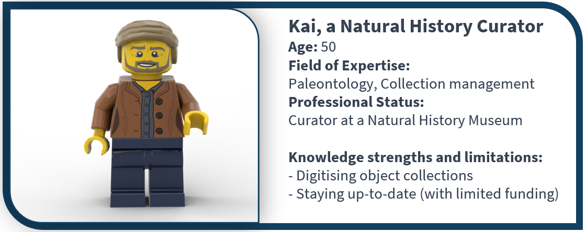
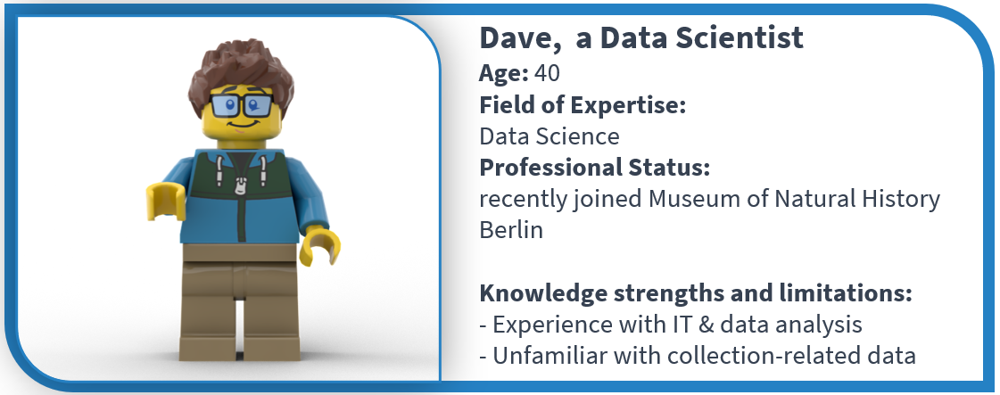
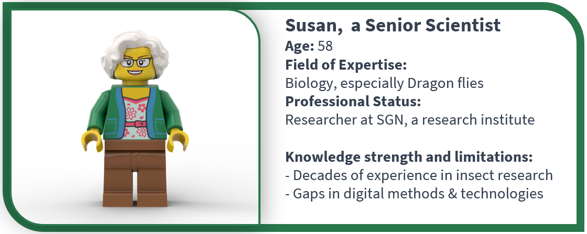
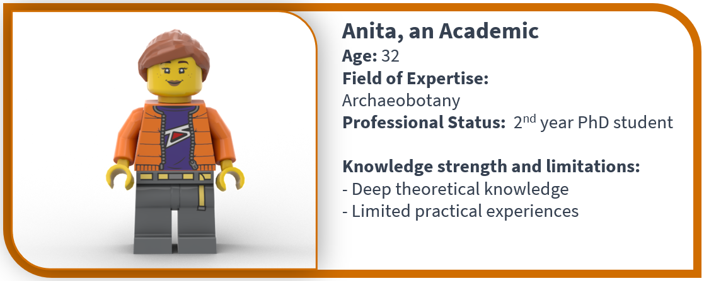
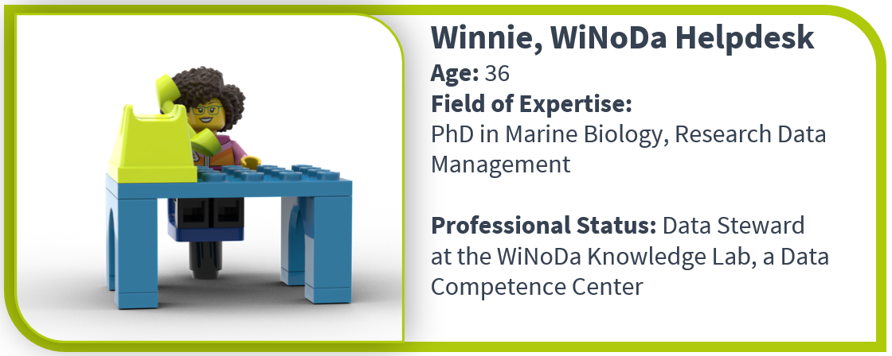
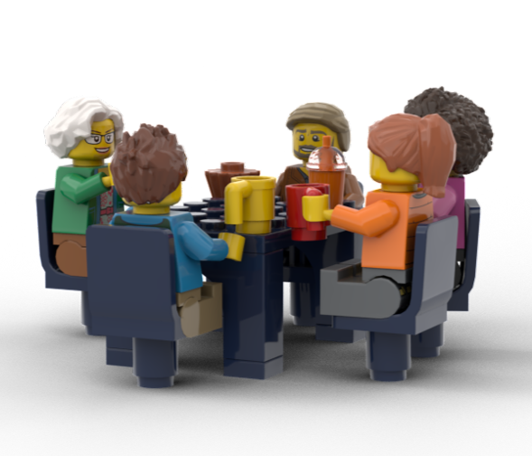
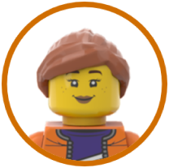

<!--
author:   Asta von Schröder

email:    asta.vonschroeder@dainst.de

version:  0.0.1

language: en

narrator: English Female

comment:  ein Test für WiNoDa Kurslayout

link:     https://cdn.jsdelivr.net/chartist.js/latest/chartist.min.css

script:   https://cdn.jsdelivr.net/chartist.js/latest/chartist.min.js
-->

# Enrichment & contextualization of object-related collection data

<!--style="color: #124061; font-family: Arial; font-size: 18pt;" -->
__About this course__ 

<!--style="color: #124061; font-family: Arial; font-size: 14pt;" -->
__Course format__ 

Online self-study course

<!--style="color: #124061; font-family: Arial; font-size: 14pt;" -->
__Target group__

Researcher in History of Earth and Humanity, professionals in science collection curation or management, data scientists

<!--style="color: #124061; font-family: Arial; font-size: 14pt;" -->
__Course level 2__ 

Intermediate
The course is aimed at people who are already familiar with basic concepts of research and collection data, especially aspects of data quality, or who are willing to acquire this knowledge in advance.

<!--style="color: #124061; font-family: Arial; font-size: 14pt;" -->
__Short Course description__

This course provides an introduction to the harmonization, validation, enrichment, and contextualization of object and find data. Using practical examples, it shows how semantic enrichment with standard data, taxonomies, and similar tools can be used to obtain structured and linked research data from heterogeneous raw data. The course introduces a variety of open online tools and services and focuses on the benefits of sharing/republishing enriched data.

The course language is English.

## Learning Objectives

<!--style="color: #124061; font-family: Arial; font-size: 14pt;" -->
__Learning Objective Matrix on the Topic of Research Data Management (RDM)__

The course creators of WiNoDa Knowledge lab used the **Learning Objective Matrix on the Topic of Research Data Management (RDM)** (from here on: LOM-RDM) as a basis the for the creation of OER. Learning objectives from the LOM-RDM can be identified by their unique identfier: Subject-ID_Topic-ID-sequential-number.

---

Petersen, B., Altemeier, F., Boße, S., Dalby, M., Düvel, N., Engelhardt, C., Fichtner, M., Hastik, C., Haugwitz, J.-M., Jacob, J., Koch, K., Kuntz, A., Manske, A., Mühlichen, A., Murcia Serra, J., Ortmeyer, J., Richter, M., Schranzhofer, H., Slowig, B., … Zollitsch, L. (2025). Learning Objectives Matrix on the Topic of Research Data Management (RDM). Zenodo. [https://doi.org/10.5281/zenodo.15846806](https://doi.org/10.5281/zenodo.15846806)

---

__WiNoDa specific adaptions__

Where necessary and appropriate, the generic learning objectives of the LOM-ROM where **adapted to fit the specific needs of the WiNoDa community,** i.e. researchers, collection managers and other persons working with object-related data from natural science collections and the history of the Earth and humanity. Adapted learning objectives received a new ID.  

New learning objectives have been assigned new IDs following a naming scheme based on the generic LOM-RDM's format, but adding a project identifier at the beginning and enumerating variations of the same with a, b,c at the end like this: WiNoDa_subject-id_topic-id_sequential number-a,b,c.  

For example, if an existing learning objective's wording was adapted: 

- 04\_004\_0861 | Learners are able to name different types of repositories.

became

- **WiNoDa**\_04\_004\_0861**a** | Learners are able to name different types of repositories **and aggregators for archaeological data.**
- **WiNoDa**\_04\_004\_0861**b** | Learners are able to name different types of repositories **and aggregators for biodiversity data.**

For completely new learning objectives within an existing topic, the sequential number was counted up, e.g.

- **WiNoDa**\_03\_003\_0677 | **Learners are able to explain the metadata schema ABCD.**

Thus, the generic LOM-RDM remains a stable reference framework for the creation of disciplinary adaptions.

---

XXXX hier unsere LZM zitieren.

---

<!-- style="color: #124061; font-family: Arial; font-size: 14pt;" -->
__Learning Objectives for this course__

**LO-ID | Complete Learning Objective**  

**Chapter 1** | **Why should we enrich data?**
- **02\_011\_0412** | Learners are able to explain the term data integration.
- **WiNoDa\_02\_011\_0417a** | Learners are able to explain goals **and benefits** of data integration.
- **01\_001\_0157** | Learners are able to explain the application of open science practices in research.
- **02\_011\_0428** | Learners are able to name challenges in data integration.
- **03\_005\_0703** | Learners are able to explain the term controlled vocabulary.
- **03\_005\_0719** | Learners are able to explain the term norm data.
- **03\_004\_0677** | Learners are able to explain examples for persistent identifiers.
- **02\_011\_0434** | Learners are able to explain data integration with heterogeneous data sources.

**Chapter 2 - Setting** | **How can we enrich data?**
- **WiNoDa\_02\_011\_0424a** | Learners are able to name **open online tools and services for data enrichment**.
- **02\_011\_0426** | Learners are able to name software for data integration.
- **03\_004\_0684** | Learners are able to apply persistent identifiers for referencing.
- **03\_005\_0704** | Learners are able to apply controlled vocabularies to describe resources.
- **03\_005\_0721** | Learners are able to apply norm data.

## Protagonists
Let's introduce our protagonists - their questions and anwsers will guide you through this course:

Kai, a collection curator at the Natural History Museum, wants to digitise his collections.

Dave, a Data Scientist at the museum, lends a lot of support and technical expertise for optimising digital workflows to this project.

Susan, a distinguished entomologist, 

and Anita, a graduate student in archaeobotany,
 work with data from the museum collection. They also support Kai’s digitisation project as taxonomic expert (Susan) and data entry staff (Anita).

The team is backed up by Winnie, who works as a data steward at a data competency centre.

## Setting 

Kai, Susan, Anita, Dave and Winnie are meeting at the museum café.

I’ve been working with our collection data for years, but I keep running into the same problem. We have information about our specimens in our collection database, but there is also relevant information in taxonomic databases, authority files, observation databases and other sources.

 The problem is that these sources were created independently and use different structures, terms and identifiers. So although the information belongs together, it is difficult to connect the records and use all these sources together. I keep wondering: how can we bring these different sources together in a meaningful way?

I know just what you mean. There are a lot of occurrence observations in the older literature that are recorded simply as place names. Many of these places have since been renamed, or their administrative boundaries have changed. It is very difficult to run large-scale data analyses on such data. There must be a way to connect these old place names to standardised geographical information.

 

I have a similar problem. In archaeology, findings are often published separately. A digging site can yield lots of different information – pottery shards, remains of buildings, human or animal remains, tools, jewellery and plant remains. But publications usually focus on one topic, so the findings are published separately and remain disconnected. It would be really useful to bring all this information together and see it in the context of the same site.

It sounds like you're actually describing three related, but slightly different challenges.
You all want to make existing data more useful by connecting it to other information. There are different ways of doing this, including **integrating, enriching and contextualising data**.

## 1. Data integration, enrichment and contextualisation 

<!---
<h3 style="display:flex;gap:18px;margin-bottom:24px;color:#124061;flex: none;">

What is data integration?  
</h3>
--->

### 

What is data integration?  

 Data integration means **bringing data from different sources together so that they can be used and understood in a common context**.
The important point is that integration is not simply putting datasets next to each other or combining them into one spreadsheet. The data need to be connected in a meaningful way.

For example, imagine that your museum has a specimen record for:
 **“Aeshna cyanea”**.
 

Another database may contain information about the species, while an authority or taxonomic service provides a persistent identifier for that species. An observation database may contain records of where and when the species was observed.
By connecting these resources, your original collection record becomes part of a larger network of information.

### 
 
What is data enrichment?

Data enrichment means **adding information to existing data to make it more complete, precise, or useful**.

The additional information can come from another dataset, a reference source, a controlled vocabulary, a taxonomy, or another external service. 
For example, your historical occurrence records may contain only an old place name. By connecting that place name to a standardised geographical name or a persistent identifier, you can add information that makes the record more precise and easier to work with. The original observation is still there, but the record has become more informative and more useful for further analysis.

Data enrichment does not necessarily mean creating a new dataset. Often, a relatively small addition — such as a standardised term, an identifier, a classification or a link to another resource — can make existing data much more useful.

### 

What is data contextualisation?

Data contextualisation means **adding or connecting information that helps us understand data in its wider context**. 
A data record rarely exists in isolation. Its meaning can depend on where, when, how and why something was found, as well as on its relationships to other objects, people, places, events or research.

For example, an archaeological find such as a pottery fragment tells us something on its own. But when we can relate it to the excavation site, the layer in which it was found, other objects from the same context, the people who excavated it and the relevant publications, we can understand the find much better.

Contextualisation is therefore about **making relationships and background information visible**, so that we can interpret and use the data appropriately.

---

 <h4 style="color: #AFCA0B; font-family: Arial; font-size: 18pt;">
 In a nutshell: </h4>

There is inevitably some overlap between these terms. It can be useful to distinguish them by their purpose: 

**Data integration** connects information from different sources so that it can be understood and used together.

**Data enrichment** adds information to existing data – for example, identifiers, standardised terms or links to other resources – to make the data more complete, precise or useful.

**Data contextualisation** connects data to information in order to help us understand its meaning, relationships and wider context.

