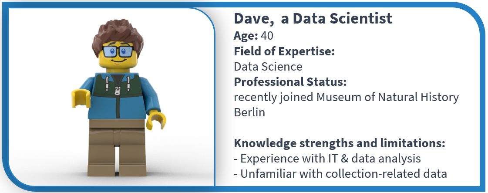
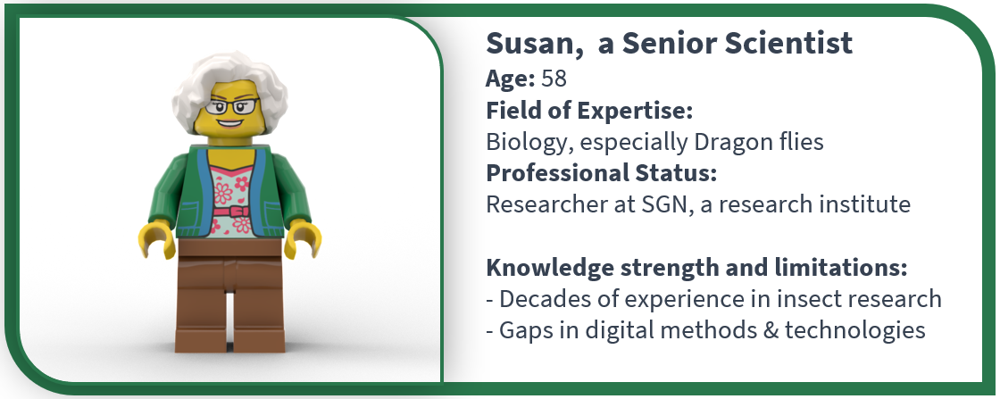
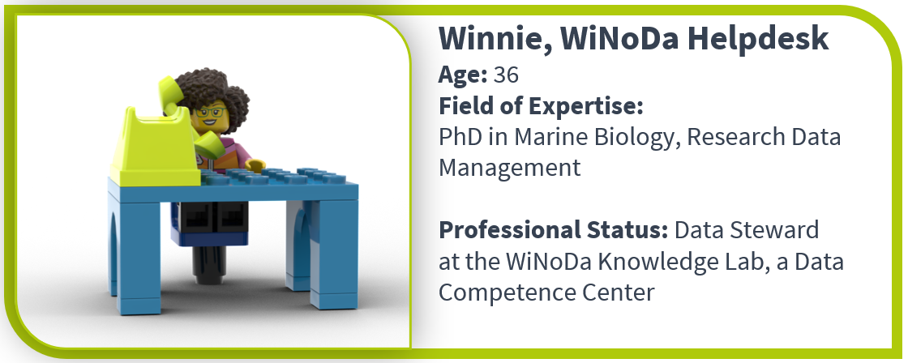

<!--
author:   Dr. Asta von Schröder (DAI) (https://orcid.org/0009-0007-5852-771X) with Anna Lisa Schwartz (GFBio) (https://orcid.org/0000-0003-0391-3879)
email:    asta.vonschroeder@dainst.de, alschwartz@gfbio.org
version:  0.0.1

language: en

narrator: English Female

comment:  **Enrichment & contextualisation of object-related collection data** was created as self-paced online course for the WiNoDa Knowledge Lab. CC BY 4.0 2026

link:     https://cdn.jsdelivr.net/chartist.js/latest/chartist.min.css

link:     https://cdn.jsdelivr.net/gh/spaetzuenderin/WiNoDa_L2.4@438c55d/WiNoDa_LiaScript-Style.css

script:   https://cdn.jsdelivr.net/chartist.js/latest/chartist.min.js


@Anita: <div class="persona persona--anita"><span class="persona__image"></span><div>@0</div></div>

@Dave: <div class="persona persona--dave"><span class="persona__image"></span><div>@0</div></div>

@Kai: <div class="persona persona--kai"><span class="persona__image"></span><div>@0</div></div>

@Susan: <div class="persona persona--susan"><span class="persona__image"></span><div>@0</div></div>

@Winnie: <div class="persona persona--winnie"><span class="persona__image"></span><div>@0</div></div>

@AnitaH: <div class="persona persona--anita"><span class="persona__image"></span><div class="persona__heading">@0</div></div>

@DaveH: <div class="persona persona--dave"><span class="persona__image"></span><div class="persona__heading">@0</div></div>

@KaiH: <div class="persona persona--kai"><span class="persona__image"></span><div class="persona__heading">@0</div></div>

@SusanH: <div class="persona persona--susan"><span class="persona__image"></span><div class="persona__heading">@0</div></div>

@WinnieH: <div class="persona persona--winnie"><span class="persona__image"></span><div  class="persona__heading">@0</div></div>

@Anita_: <div class="persona persona--anita"><span class="persona__image"></span><div>@0</div></div>

@Dave_: <div class="persona persona--dave"><span class="persona__image"></span><div>@0</div></div>

@Kai_: <div class="persona persona--kai"><span class="persona__image"></span><div>@0</div></div>

@Susan_: <div class="persona persona--susan"><span class="persona__image"></span><div>@0</div></div>

@Winnie_: <div class="persona persona--winnie"><span class="persona__image"></span><div>@0</div></div>


@ExampleA
<div class="example">
<div class="example__image">


</div>
<div class="exampleA__text">

@0

</div>
</div>
@end

@ExampleB
<div class="example">
<div class="example__image">


</div>
<div class="exampleB__text">

@0

</div>
</div>
@end

@ExampleC
<div class="example">
<div class="example__image">


</div>
<div class="exampleC__text">

@0

</div>
</div>
@end


-->


# Enrichment & contextualization of object-related collection data

<!--style="color: #124061; font-family: Arial; font-size: 18pt;" -->
__About this course__ 


<!--style="color: #124061; font-family: Arial; font-size: 14pt;" -->
__Course format__ 

Online self-study course

<!--style="color: #124061; font-family: Arial; font-size: 14pt;" -->
__Target group__

Researcher in History of Earth and Humanity, professionals in science collection curation or management, data scientists

<!--style="color: #124061; font-family: Arial; font-size: 14pt;" -->
__Course level 2__ 

Intermediate
The course is aimed at people who are already familiar with basic concepts of research and collection data, especially aspects of data quality, or who are willing to acquire this knowledge in advance.

<!--style="color: #124061; font-family: Arial; font-size: 14pt;" -->
__Short Course description__

This course provides an introduction to the harmonization, validation, enrichment, and contextualization of object and find data. Using practical examples, it shows how semantic enrichment with standard data, taxonomies, and similar tools can be used to obtain structured and linked research data from heterogeneous raw data. The course introduces a variety of open online tools and services and focuses on the benefits of sharing/republishing enriched data.

The course language is English.

## Learning Objectives


__Learning Objective Matrix on the Topic of Research Data Management (RDM)__

The course creators of WiNoDa Knowledge lab used the **Learning Objective Matrix on the Topic of Research Data Management (RDM)** (from here on: LOM-RDM) as a basis the for the creation of OER. Learning objectives from the LOM-RDM can be identified by their unique identfier: Subject-ID_Topic-ID-sequential-number.

---

> Petersen, B., Altemeier, F., Boße, S., Dalby, M., Düvel, N., Engelhardt, C., Fichtner, M., Hastik, C., Haugwitz, J.-M., Jacob, J., Koch, K., Kuntz, A., Manske, A., Mühlichen, A., Murcia Serra, J., Ortmeyer, J., Richter, M., Schranzhofer, H., Slowig, B., … Zollitsch, L. (2025). Learning Objectives Matrix on the Topic of Research Data Management (RDM). Zenodo. [https://doi.org/10.5281/zenodo.15846806](https://doi.org/10.5281/zenodo.15846806)

---

__WiNoDa specific adaptions__

Where necessary and appropriate, the generic learning objectives of the LOM-ROM where **adapted to fit the specific needs of the WiNoDa community,** i.e. researchers, collection managers and other persons working with object-related data from natural science collections and the history of the Earth and humanity. Adapted learning objectives received a new ID.  

New learning objectives have been assigned new IDs following a naming scheme based on the generic LOM-RDM's format, but adding a project identifier at the beginning and enumerating variations of the same with a, b,c at the end like this: WiNoDa_subject-id_topic-id_sequential number-a,b,c.  

For example, if an existing learning objective's wording was adapted: 

- 04\_004\_0861 | Learners are able to name different types of repositories.

became

- **WiNoDa**\_04\_004\_0861**a** | Learners are able to name different types of repositories **and aggregators for archaeological data.**
- **WiNoDa**\_04\_004\_0861**b** | Learners are able to name different types of repositories **and aggregators for biodiversity data.**

For completely new learning objectives within an existing topic, the sequential number was counted up, e.g.

- **WiNoDa**\_03\_003\_0677 | **Learners are able to explain the metadata schema ABCD.**

Thus, the generic LOM-RDM remains a stable reference framework for the creation of disciplinary adaptions.

---

> XXXX hier unsere LZM zitieren.

---


__Learning Objectives for this course__

<!--- **LO-ID | Complete Learning Objective**  --->

**Chapter 1** | **Why should we enrich data?**
- **02\_011\_0412** | Learners are able to explain the term data integration.
- **WiNoDa\_02\_011\_0417a** | Learners are able to explain goals **and benefits** of data integration.
- **01\_001\_0157** | Learners are able to explain the application of open science practices in research.
- **02\_011\_0428** | Learners are able to name challenges in data integration.
- **03\_005\_0703** | Learners are able to explain the term controlled vocabulary.
- **03\_005\_0719** | Learners are able to explain the term norm data.
- **03\_004\_0677** | Learners are able to explain examples for persistent identifiers.
- **02\_011\_0434** | Learners are able to explain data integration with heterogeneous data sources.


**Chapter 2 - Setting** | **How can we enrich data?**
- **WiNoDa\_02\_011\_0424a** | Learners are able to name **open online tools and services for data enrichment**.
- **02\_011\_0426** | Learners are able to name software for data integration.
- **03\_004\_0684** | Learners are able to apply persistent identifiers for referencing.
- **03\_005\_0704** | Learners are able to apply controlled vocabularies to describe resources.
- **03\_005\_0721** | Learners are able to apply norm data.

## Protagonists
Let's introduce our protagonists - their questions and anwsers will guide you through this course:
<div class=persona--kai>
Kai, a collection curator at the Natural History Museum, wants to digitise his collections.
</div>

Dave, a Data Scientist at the museum, lends a lot of support and technical expertise for optimising digital workflows to this project.

Susan, a distinguished entomologist, 

and Anita, a graduate student in archaeobotany,
 work with data from the museum collection. They also support Kai’s digitisation project as taxonomic expert (Susan) and data entry staff (Anita).
The team is backed up by Winnie, who works as a data steward at a data competency centre.


## 1. Data integration, enrichment and contextualisation  

Kai, Susan, Anita, Dave and Winnie are meeting at the museum café.
 

@Kai(```<p>I’ve been working with our collection data for years, but I keep running into the same problem. We have information about our specimens in our collection database, but there is also relevant information in taxonomic databases, authority files, observation databases and other sources.</p>
<p> The problem is that these sources were created independently and use different structures, terms and identifiers. So although the information belongs together, it is difficult to connect the records and use all these sources together. I keep wondering: how can we bring these different sources together in a meaningful way?</p>```)

@Susan(```<p>I know just what you mean. <br>There are a lot of occurrence observations in the older literature that are recorded simply as place names. Many of these places have since been renamed, or their administrative boundaries have changed. <br>It is very difficult to run large-scale data analyses on such data. There must be a way to connect these old place names to standardised geographical information.</p>```)


@Anita(```
<p>I have a similar problem. <br>In archaeology, findings are often published separately. A digging site can yield lots of different information – pottery shards, remains of buildings, human or animal remains, tools, jewellery and plant remains.</p><p> But publications usually focus on one topic, so the findings are published separately and remain disconnected. It would be really useful to bring all this information together and see it in the context of the same site.</p>```)

@Winnie_(```
<p>
It sounds like you're actually describing three related, but slightly different challenges.
You all want to make existing data more useful by connecting it to other information. There are different ways of doing this, including **integrating, enriching and contextualising data**.
</p>
```)


### Data integration

@KaiH(```What is data integration?```)


@Winnie_(```
<p> Data integration means **bringing data from different sources together so that they can be used and understood in a common context**.
The important point is that integration is not simply putting datasets next to each other or combining them into one spreadsheet. The data need to be connected in a meaningful way.
</p>
<p>
For example, imagine that your museum has a specimen record for:
 **“Aeshna cyanea”**.
 </p>
<p>
Another database may contain information about the species, while an authority or taxonomic service provides a persistent identifier for that species. An observation database may contain records of where and when the species was observed.
By connecting these resources, your original collection record becomes part of a larger network of information.
</p>
```)


### Data enrichment
@SusanH(```What is data enrichment?```)

@Winnie_(```
<p>Data enrichment means **adding information to existing data to make it more complete, precise, or useful**.</p>
<p>The additional information can come from another dataset, a reference source, a controlled vocabulary, a taxonomy, or another external service.<br>
For example, your historical occurrence records may contain only an old place name. By connecting that place name to a standardised geographical name or a persistent identifier, you can add information that makes the record more precise and easier to work with. The original observation is still there, but the record has become more informative and more useful for further analysis.</p>
<p>Data enrichment does not necessarily mean creating a new dataset. Often, a relatively small addition — such as a standardised term, an identifier, a classification or a link to another resource — can make existing data much more useful.</p>
```)


### Data contextualisation
@AnitaH(```
What is data contextualisation?
```)

@Winnie_(```
<p>Data contextualisation means **adding or connecting information that helps us understand data in its wider context**.<br>
A data record rarely exists in isolation. Its meaning can depend on where, when, how and why something was found, as well as on its relationships to other objects, people, places, events or research.</p>
<p>For example, an archaeological find such as a pottery fragment tells us something on its own. But when we can relate it to the excavation site, the layer in which it was found, other objects from the same context, the people who excavated it and the relevant publications, we can understand the find much better.</p>
<P>Contextualisation is therefore about **making relationships and background information visible**, so that we can interpret and use the data appropriately.</p>```)

---

 <p class="nutshell"> In a nutshell: </p>
<div class="persona--dave">
<p>There is inevitably some overlap between these terms. It can be useful to distinguish them by their purpose: 
</p>

<p>
 **Data integration** connects information from different sources so that it can be understood and used together.
</p>
<p>
 **Data enrichment** adds information to existing data – for example, identifiers, standardised terms or links to other resources – to make the data more complete, precise or useful.
</p>
<p>
 **Data contextualisation** connects data to information in order to help us understand its meaning, relationships and wider context.
 </p>

</div>


### Quiz 1
<!---
style
.lia-figure {
  float: none !important;
  max-width: 100% !important;
  width: 100% !important;
  margin: 0 !important;
}
--->

<div style="display: flex; align-items: flex-start; gap: 1em;">

<div style="flex: 0 0 30%; min-width: 0;">

<!--
width="100%"-->

</div>
<div class="persona--winnie">
Let's repeat what we have learned.<br>
Klick the arrows on the green button to proceed.
</div>
</div>

<!--- ### Question 1 — 02_011_0412_Mulitple-Choice_1 -->
{{1-2}}
<section>

**Which example best illustrates data enrichment?**

<!-- data-randomize="false" 
data-hint-button="2" 
data-text-solved="B is correct! A and D primarily describe data integration. C describes contextualisation."
-->

- [( )] A: Connecting a museum specimen record with an external taxonomic database so that information from both sources can be used together.
- [(x)] B: Adding a persistent identifier and a standardised species name to an existing museum specimen record.
- [( )] C: Connecting an archaeological find with the excavation site, associated finds and relevant publications.
- [( )] D: Combining records from several databases into a single integrated research database.

[[?]] Think - what do you need to add to make an existing record more complete and useful?  

</section>


<!--- ### Question 2 — 02_011_0412_Mulitple-Choice_2 --->
{{2-3}}
<section>

**A museum has specimen records, an external taxonomic database and an observation database. The museum connects records from all three sources using persistent identifiers so that users can navigate between them. What is this primarily an example of?**

<!-- data-randomize="false" 
data-hint-button="2" 
data-text-solved="Exactly! Enrichment may take place as part of this process, but the defining feature here is the integration of different sources."
-->

- [( )] A: Data enrichment
- [( )] B: Data contextualisation
- [(x)] C: Data integration
- [( )] D: Data cleaning

[[?]] How do we call it if information from different sources is being connected so that it can be used together?  

</section>


<!--- ### Question 3 — 02_011_0412_Mulitple-Choice_3 --->
{{3-4}}
<section>

**An archaeologist has a record for a bone fragment. She links it to the excavation site, the archaeological layer where it was found, other objects found in the same layer and publications discussing the site. What is the main purpose of these connections?**

<!-- data-randomize="false" 
data-hint-button="2" 
data-text-solved="Correct! The other activities can be useful, but they are not the main purpose described here."
-->

- [( )] A: To enrich the record with additional information
- [(x)] B: To contextualise the find by showing its wider relationships and background
- [( )] C: To integrate several databases into one physical database
- [( )] D: To standardise the spelling of the object's name

[[?]] All these additional information establish the ....?
</section>


<!--- ### Question 4 — 02_011_0412_True-False --->
{{4-5}}
<section>

**True or false?**

<!-- 
data-text-solved="True! Adding the identifier enriches the existing record. If the identifier is then used to connect that record with information from other sources, it can also contribute to data integration. The concepts can therefore overlap."
-->

Adding a persistent identifier to an existing record can be an example of data enrichment, even though that identifier may subsequently be used to integrate the record with other datasets.

- [(x)]True
- [( )] False

</section>


{{5}}
<section>

<!--- ### Question 5 — 02_011_0412_Drag-the-Words 
import: https://raw.githubusercontent.com/MINT-the-GAP/lia-Kachel/main/README.md
--->

**For each example, choose the concept that best describes its primary purpose. Remember that the three concepts can overlap.**

<div class="Kachel">

<!-- data-randomize="true" 
data-text-solved="Well done!"
-->

1. A researcher adds the country code and geographic coordinates to historical specimen records.  
   [->[Data contextualisation|(Data enrichment)|Data integration]]

2. A museum connects its catalogue with an external database of digitised historical photographs, allowing users to move between the object record and the corresponding images.  
   [->[Data enrichment|(Data integration)|Data contextualisation]]

3. A researcher links a historical manuscript to the people, institution and historical event mentioned in it to better understand its significance.  
   [->[Data integration|(Data contextualisation)|Data enrichment]]

4. A data steward adds standardised language codes to records containing descriptions in several languages.  
   [->[Data contextualisation|Data integration|(Data enrichment)]]

5. A researcher connects datasets from several laboratories so that measurements referring to the same research samples can be analysed together.  
   [->[Data contextualisation|(Data integration)|Data enrichment]]

</div>
</section>

## 2. Goals and Benefits of Data Integration

@Anita(```I understand that by adding information we can enrich and contextualise data, but what are we trying to achieve? Do we simply want to put everything in one place?```)

### Goals
@AnitaH(```What are the goals of data integration?```)

@Winnie_(```<p>Not necessarily.<br> The main goal is to **make information from different sources work together**. This allows us to ask questions that could not be answered using the individual datasets separately.</p>
<p>Take an archaeobotanical example.</p>```)

<!--->

<div class="exampleA__text"><h4>Example</h4>
Researchers have published information about plant remains from many different archaeological sites over a long period of time. If these records are brought together in a structured way, we can investigate patterns across sites, periods and regions rather than looking at each publication in isolation. <br>
This was done with the **Archaeobotanical Geodatabase** of the Early Iron Age – Early Middle Ages in the Forest Zone of the East European Plain. It brings together information from 373 previously published assemblages from 321 archaeological sites and combines the database with supporting image and GIS data.<br>
[https://archaeologydataservice.ac.uk/archives/collections/view/1006631/index.cfm](https://archaeologydataservice.ac.uk/archives/collections/view/1006631/index.cfm)
</div>
--->

@ExampleA(```<h4>Example</h4><p>
Researchers have published information about plant remains from many different archaeological sites over a long period of time. If these records are brought together in a structured way, we can investigate patterns across sites, periods and regions rather than looking at each publication in isolation.</p>
<p>This was done with the **Archaeobotanical Geodatabase** of the Early Iron Age – Early Middle Ages in the Forest Zone of the East European Plain. It brings together information from 373 previously published assemblages from 321 archaeological sites and combines the database with supporting image and GIS data.<br>
[https://archaeologydataservice.ac.uk/archives/collections/view/1006631/index.cfm](https://archaeologydataservice.ac.uk/archives/collections/view/1006631/index.cfm)
</p>```)


@Winnie_(```<p>Depending on the research question, goals of data integration can include:</p>
<ul>
<li>  **combining complementary information** from different sources;</li>
<li>  **making connections between records and resources**;</li>
<li>  **enabling cross-dataset searches and analyses**;</li>
<li>  **identifying patterns and relationships** that are difficult to see in individual datasets;</li>
<li>  **making heterogeneous data more interoperable and reusable**.</li>
</ul>
```)

### Benefits
@KaiH(```That makes sense. But what are the benefits of data integration for researchers? Why is it worth the effort?```)

@Winnie_(```<p>Integration can make existing data **more discoverable, more comparable and more useful for new research questions**.</p>
<p>Instead of having to search and analyse each source separately, researchers can work across connected information. This can save time, reveal relationships that would otherwise remain hidden and make it possible to reuse existing data in new ways.
There is also a benefit beyond the original research project. When data are integrated and made interoperable, they can become part of a wider research infrastructure. Other researchers can discover the data, combine them with other resources and ask questions that the original data creators may never have considered.</p>
<p>In other words, **integration increases the potential value of existing data**, not only for the original researcher, but also for others who may want to reuse or build on it.</p>```)

---

<p class=nutshell> In a nutshell:</p>
<div style="color:#2581C4;">
The **goal** of data integration is to make data from different sources work together. 
The **benefit** is that integrated data can support new connections, analyses and forms of reuse that would not be possible – or would be much harder – when the data remain isolated.
</div>

---

### Example 1: STAR and STELLAR

<!---
style
.lia-figure {
  float: none !important;
  max-width: 100% !important;
  width: 100% !important;
  margin: 0 !important;
}
--->
<div style="display: flex; align-items: flex-start; gap: 1em;">
<div style="flex: 0 0 30%; min-width: 0;">

</div>
<div class="exampleA__text">
Integrating semantic information such as persistent identifiers, authority data and controlled vocabularies can improve discoverability, accessibility, impact and sustainability. Projects such as **STAR** and **STELLAR** demonstrate how this can support interoperability across archaeological datasets.


**STAR – Semantic Technologies for Archaeological Resources**  
An AHRC-funded project (2007–2010) involving the University of Glamorgan and English Heritage, STAR aimed to make diverse archaeological datasets and _grey literature_ searchable together. It mapped five archaeological databases and extracts from the OASIS library to the **CIDOC Conceptual Reference Model (CIDOC CRM)** and its archaeological extension, CRM-EH. This allowed datasets with different structures and terminology to be cross-searched. The project produced a research demonstrator, semantic terminology services and RDF representations of archaeological data. The project has concluded, but its outputs and subsequent work are documented by the Archaeology Data Service (ADS).
+ https://archaeologydataservice.ac.uk/about/projects/star/ 
+ https://www.southwales.ac.uk/research/research-and-innovation-groups/computing-cybersecurity-mathematics-and-informatics/ 
+ (https://archaeologydataservice.ac.uk/). 


**STELLAR – Semantic Technologies Enhancing Links and Linked Data for Archaeological Resources**  
STELLAR (2010–2011) built on STAR by developing tools and guidelines that made it easier for data providers to map archaeological datasets to **CIDOC CRM-EH** and publish them as **RDF Linked Data**. Several ADS excavation datasets served as case studies, and the resulting Linked Data was published through the **ADS Linked Data repository**. 
+ https://archaeologydataservice.ac.uk/about/projects/stellar/
+ https://www.southwales.ac.uk/research/research-and-innovation-groups/computing-cybersecurity-mathematics-and-informatics/
+ (https://data.archaeologydataservice.ac.uk/)

**STAR and STELLAR illustrate an important goal of data integration: making heterogeneous datasets work together without requiring their original creators to have used exactly the same database structure or terminology.**  By mapping heterogeneous resources to a shared semantic framework, they can be **connected, searched and reused together while retaining their original structures and contexts**.
</div>
</div>

>**Related publications and resources**<br>
>>Tudhope, D., Binding, C., Jeffrey, S., May, K., & Vlachidis, A. (2011). A STELLAR role for knowledge organization systems in digital archaeology. _Bulletin of the American Society for Information Science and Technology_, _37_(4), 15–18. https://doi.org/10.1002/bult.2011.1720370405
>
>>Charno, M., Jeffrey, S., Binding, C., Tudhope, D., & May, K. (2013). From the Slope of Enlightenment to the Plateau of Productivity: Developing Linked Data at the ADS. In G. Earl, T. Sly, A. Chrysanthi, P. Murrieta-Flores, C. Papadopoulos, I. Romanowska, & D. Wheatley (Eds.), _Archaeology in the Digital Era: Papers from the 40th Annual Conference of Computer Applications and Quantitative Methods in Archaeology (CAA), Southampton, 26-29 March 2012_ (pp. 216-223). Amsterdam University Press. http://dare.uva.nl/cgi/arno/show.cgi?fid=516092
>
>>Binding, C., Charno, M., Jeffrey, S., May, K., & Tudhope, D. (2015). Template Based Semantic Integration: From Legacy Archaeological Datasets to Linked Data. _International Journal on Semantic Web and Information Systems (IJSWIS), 11_(1), 1-29. https://doi.org/10.4018/IJSWIS.2015010101

---
### Example 2: DiSSCo – Distributed System of Scientific Collections

<!---

style

.lia-figure {

  float: none !important;

  max-width: 100% !important;

  width: 100% !important;

  margin: 0 !important;

}

--->

<div style="display: flex; align-items: flex-start; gap: 1em;">

<div style="flex: 0 0 30%; min-width: 0;">


</div>

<div class="exampleB__text">
**DiSSCo (Distributed System of Scientific Collections)** is a pan-European research infrastructure that aims to connect natural-science collections held by museums, botanical gardens, universities and research institutions. Its network brings together more than **400 institutions in 23 countries**, representing around **1.5 billion specimens**. Rather than centralising these collections, DiSSCo aims to make their data interoperable through shared standards, services, identifiers and governance. <br>
https://www.dissco.eu/

DiSSCo was added to the **ESFRI Roadmap in 2018**. The **DiSSCo Prepare** project (2020–2023) developed the technical, scientific and organisational foundations for the infrastructure, followed by **DiSSCo Transition** (2023–2025), which focused on moving towards construction and establishing core services and governance. 
+ https://www.dissco.eu/dissco-has-been-officially-accepted-on-the-esfri-roadmap/
+ https://cordis.europa.eu/project/id/871043
+ https://cordis.europa.eu/project/id/101130121

A key concept is the **Digital Specimen**: a FAIR digital representation of an individual physical specimen with a persistent digital identity. This provides a common point for connecting different types of information, such as images, taxonomy, genomic and ecological data, publications and annotations. In 2025, DiSSCo reported that more than **five million digital specimens and media objects** were available through its DiSSCover platform and could be referenced using DOIs. 
+ https://www.dissco.eu/digital-specimen-dissco/
+ https://www.dissco.eu/five-million-dois/

DiSSCo therefore illustrates that data integration does not require **centralising the original data**. Instead, distributed collections can be connected through shared identifiers, standards and relationships, making information about the same specimens more findable, interoperable and reusable across institutions and research domains.
</div>
</div>


>**Related publications and resources**
>>Koureas, D., Addink, W., & Hardisty, A. (2018). Digital Object Cloud for linking natural science collections information; The case of DiSSCo. _Biodiversity Information Science and Standards_, _2_, e25474. https://doi.org/10.3897/biss.2.25474
>
>>Addink, W., & Hardisty, A. (2020). ‘openDS’ – Progress on the New Standard for Digital Specimens. _Biodiversity Information Science and Standards_, _4_, e59338. https://doi.org/10.3897/biss.4.59338
>
>>Hardisty, A. R., Ellwood, E. R., Nelson, G., Zimkus, B., Buschbom, J., Addink, W., Rabeler, R. K., Bates, J., Bentley, A., Fortes, J. A. B., Hansen, S., Macklin, J. A., Mast, A. R., Miller, J. T., Monfils, A. K., Paul, D. L., Wallis, E., & Webster, M. (2022). Digital Extended Specimens: Enabling an Extensible Network of Biodiversity Data Records as Integrated Digital Objects on the Internet. _BioScience_, _72_(10), 978–987. https://doi.org/10.1093/biosci/biac060

---

### Quiz 2

<!---
style
.lia-figure {
  float: none !important;
  max-width: 100% !important;
  width: 100% !important;
  margin: 0 !important;
}
--->

<div style="display: flex; align-items: flex-start; gap: 1em;">

<div style="flex: 0 0 30%; min-width: 0;">

<!--
width="100%"-->

</div>
<div class="persona--winnie">
Let's repeat what we have learned.<br>
Klick the arrows on the green button to proceed.
</div>
</div>

<!---  Question 1 - WiNoDa_02_011_0417a_Multiple-Choice_1--->

{{1-2}}
<section>

**What is the main goal of data integration?**

<!-- data-text-solved="Correct! This is the central goal of data integration: connecting information so that it can be used together." -->

- [(X)] A. To make information from different sources work together
- [( )] B. To replace all existing databases with one database
- [( )] C. To standardise every dataset into exactly the same structure
- [( )] D. To preserve datasets so they cannot be changed or reused

</section>

<!--- Question 2
WiNoDa_02_011_0417a_Multiple-Choice_2 --->

{{2-3}}
<section>

**Which of the following are potential benefits of data integration rather than explicit goals?** (Mark all applicable options)

<!-- data-text-solved="Correct! Identifying new patterns, saving researchers time and enabling new forms of data reuse are potential benefits of data integration. Making heterogeneous data interoperable is a central goal rather than a benefit." -->

- [[X]] A. Identifying patterns across previously separate datasets
- [[ ]] B. Making heterogeneous data interoperable
- [[X]] C. Saving researchers time when searching for information
- [[X]] D. Enabling new forms of data reuse

</section>

<!--- Question 3
WiNoDa_02_011_0417a_Multiple-Choice_3 --->

{{3-4}}
<section>

**Why does data integration not necessarily require putting all data into one central database?**

<!-- data-text-solved="Correct! Integration can connect distributed resources through shared structures, identifiers and relationships without centralising the original data." -->

- [(X)] A. Because datasets can be connected through meaningful relationships
- [( )] B. Because separate datasets cannot be searched together
- [( )] C. Because databases are unrelated to data integration
- [( )] D. Because only published data can be integrated

</section>

<!--- Question 4 
WiNoDa_02_011_0417a_Multiple-Choice_4 --->

{{4}}
<section>

**What is a key benefit of making data interoperable and connected?**

<!-- data-text-solved="Correct! Interoperable data can be discovered, connected and reused to support research questions beyond the original project." -->

- [(X)] A. Researchers can combine existing information to investigate new questions
- [( )] B. Researchers no longer need to understand the source data
- [( )] C. All differences between datasets automatically disappear
- [( )] D. The original data creators determine every future use

</section>


## 3. Relation to Open Science practices


@Kai(```So, if integration makes existing data more useful to other researchers, what do we need to do to make that reuse possible?```)

@Winnie_(```This is where **Open Science practices** become important. Data integration works best when research outputs are made accessible, understandable and reusable beyond the original project.```)

### Open Science - more than Open Access

@AnitaH(```But isn't open science mainly about making data and publications **openly available**?```)

@Winnie_(```<p>
Open access publishing and open data are important parts, but open science is more than that. The aim is to make different parts of the research process and its outputs as open, accessible and reusable as appropriate.
</p>
<p>
Open science does not stop at making research data available. It involves a range of practices that can make research more transparent, accessible and reusable, **at every step of the research process.** Depending on the research context, this can include sharing research data, using open and interoperable formats, providing documentation and metadata, publishing methods and workflows, or using persistent identifiers.
</p>
<p>
For example, a dataset is much more useful to others when they can not only access it, but also understand what the data represent, how they were collected, how they were processed and how they can be reused. Clear documentation, metadata, licensing and persistent identifiers all contribute to this.
</p>
<p>
This also connects directly to data integration. When datasets are well and consistently described, use persistent identifiers and are available in interoperable formats, it becomes easier to discover, connect and combine them with other resources.
</p>
```)

<!-- style="color: #AFCA0B; font-family: Arial; font-size: 1.5em;" -->
In a nutshell:

<!-- style="color: #2581C4" -->
Open science practices help make research outputs accessible, understandable and reusable. They therefore provide important foundations for data integration and for enabling researchers to build on existing work.


>[!TIP]
>>For more information on reusability and the role of PID (persistent identifiers), see our courses:
>> + RRP - Reusability and its relevance
>> + RRP - Reusing object-related research data

### Benefits of sharing data 

@SusanH(```So, if I share my enriched data and republish them, I can help other researchers build on my work? But… what if they take the credit for my work?```)

@Winnie_(```
<p>
Sharing enriched data can indeed help other researchers build on existing work. But **sharing does not mean giving up attribution or provenance**. Persistent identifiers, clear documentation, versioning and appropriate citation can help make contributions visible and traceable.
</p>
<p>
Integrating and enriching collection data therefore creates benefits not only for the researchers who do the work. When those enrichments are shared, they can become a resource for others as well.
</p>
<p>
For example, a researcher might add persistent identifiers, improved metadata, links to authority records, geographic information or connections to other resources to an existing collection dataset. If these enrichments are shared, they can improve the dataset for future users and make it easier to connect with other research resources.
</p> ```)


<div class="persona--winnie">
<p>
In this sense, data enrichment can be understood as a form of “giving back”: researchers contribute improvements that increase the value and usability of data beyond the original project.
</p>
<p>
It's the famous Boy Scout rule:<br> 
>>>"Try and leave this world (in this case: your data) a little better than you found it."
</p>
<p>
This contributes to an open research ecosystem in which data can be:
</p>
<ul>
<li> discovered by other researchers;</li>
<li> connected to related datasets and resources;</li>
<li> reused for new research questions;</li>
<li> improved and enriched further by others.</li>
</ul>
<p>
The result is not simply a better dataset, but a cycle of reuse and enrichment: researchers use existing data, add value to them, and share those improvements so that others can build on them.
</p>
</div>


<!-- style="color: #AFCA0B; font-family: Arial; font-size: 1.5em;" -->
In a nutshell:  

<!-- style="color: #2581C4" -->
Sharing enriched data helps create a research ecosystem in which existing data can be improved, connected and reused by others. And with appropriate attribution and provenance, sharing can make your contribution even more visible rather than making it disappear.


> [!NOTE] Related publications and resources
>>+ UNESCO – Recommendation on Open Science (2021)
>>+ UNESCO – Recommendation on Open Science
>>+ UNESCO – An introduction to the UNESCO Recommendation on Open Science (2022)
>>+ UNESCO & Canadian National Commission for UNESCO. (2022). An introduction to the UNESCO Recommendation on Open Science. UNESCO. https://doi.org/10.54677/XOIR1696

>[!NOTE] FAIR Principles
>>Wilkinson, M. D., Dumontier, M., Aalbersberg, Ij. J., Appleton, G., Axton, M., Baak, A., Blomberg, N., Boiten, J.-W., Da Silva Santos, L. B., Bourne, P. E., Bouwman, J., Brookes, A. J., Clark, T., Crosas, M., Dillo, I., Dumon, O., Edmunds, S., Evelo, C. T., Finkers, R., … Mons, B. (2016). The FAIR Guiding Principles for scientific data management and stewardship. Scientific Data, 3(1), 160018. https://doi.org/10.1038/sdata.2016.18

### Quiz 3
<!---
style
.lia-figure {
  float: none !important;
  max-width: 100% !important;
  width: 100% !important;
  margin: 0 !important;
}
--->

<div style="display: flex; align-items: flex-start; gap: 1em;">

<div style="flex: 0 0 30%; min-width: 0;">

<!--
width="100%"-->

</div>
<div class="persona--winnie">
Let's repeat what we have learned.<br>
Klick the arrows on the green button to proceed.
</div>
</div>

<!--- Question 1 — 01_001_0157_Multiple-Choice_1 --->

{{1-2}}
<section>
<!-- 
data-randomize="true" 
data-text-solved="Correct! Open Science encompasses a range of practices, including Open Data, documentation, methods, workflows and persistent identifiers." 
-->

Which statement best describes the relationship between Open Science and Open Data?

[( )] Open Science and Open Data are two terms for exactly the same practice.

[(X)] Open Data is one part of the broader Open Science approach.

[( )] Open Science means that every research output must always be completely open.

[( )] Open Data is only relevant after a research project has been completed.
</section>


<!--- Question 2 — 01_001_0157_Multiple-Choice_2 --->
{{2-3}}
<section>
<!-- 
data-randomize="true" 
data-text-solved="Correct! Sharing enrichments can make existing data more useful and easier to connect with related resources and reuse for new research." 
-->

A researcher enriches an existing collection dataset with persistent identifiers, improved metadata and links to other resources, then shares those enrichments. What is a key benefit for the wider research community?

[(X)] Other researchers can discover, connect and reuse the improved data.

[( )] The original dataset no longer needs its source or provenance information.

[( )] All researchers must use the enriched dataset in exactly the same way.

[( )] The researcher automatically becomes the author of all future research using the data.
</section>


<!--- Question 3 — 01_001_0157_Multiple-Choice_3 --->
{{3}}
<section>
<!-- 
data-randomize="true" 
data-text-solved="Correct! Enriching and sharing data contributes improvements that can benefit researchers beyond the original project and support further reuse." 
-->

Why can sharing enriched data be described as “giving back” to the research community?

[(X)] Because researchers can improve existing resources and make those improvements available for others to build on.

[( )] Because researchers must give up attribution when they share their data.

[( )] Because shared data can only be used by the researcher who created the enrichment.

[( )] Because every shared dataset must be merged into one central research database.
</section>


## 4. Challenges in Data Integration

 
@Susan(```So we've talked about why data integration is useful and how Open Science practices can help. But it is probably not as easy as it sounds...```)

### Structural heterogeneity
@SusanH(```Which challenges exist in data integration?```)

@Winnie_(```<p>You're right to be cautious, Susan. <br>Integration brings real benefits, but it also comes with challenges. Understanding these helps explain why certain practices and standards have developed.</p>```)

@Kai(```<p>From a collection perspective, one obvious challenge is that different institutions document things differently.</p><p>Even within natural history, one museum might record specimen data in one format, another museum uses different fields, and a third might have information locked up in old card catalogues or PDFs.</p>```)

@Dave_(```<p>That's what we call **structural heterogeneity**.<br>The same kind of information exists, but it's organised differently in each dataset. Technically, you can't just merge those tables and expect meaningful results.</p>```)

### Semantic heterogeneity
@Anita(```<p>We see something similar in archaeology. <br>One excavation project might record plant remains with detailed taxonomic information, another might use more general categories, and a third might not record certain types of evidence at all.</p> <p class="persona__heading">How do you integrate datasets when they don't even ask the same questions?</p>```)

@Winnie_(```<p>That touches on a second challenge: **semantic heterogeneity**. Even when datasets have similar structures, they may use different terms or concepts to describe the same thing.</p><p> For example, one dataset might use "Iron Age" while another uses "Early Iron Age" or a specific date range.</p>```)

@Susan(```<p>Also: the terminology isn't always consistent even within a single research community: Different researchers, different time periods, different languages.</p><p>**It can be quite confusing and time-consuming to understand whether we even talk about the same thing.**</p>```)

@Winnie_(```<p>That's why we use **controlled vocabularies** and **authority records**.</p>```)

@Dave_(```<p>From a technical angle, there's also the question of **identifiers**. If you want to connect records about the same specimen, site, or publication across different datasets, you need a reliable way to know they're talking about the same thing.</p>```)

@Anita(```<p>Like if I'm working with plant remains from Site A, and someone else has published on Site A, but we're using different site codes or names, **how do we know we're referring to the same place?**</p>```)

@Winnie_(```<p>Precisely. That's where **persistent identifiers** come in. But not all datasets use them, and older datasets especially may have no stable identifiers at all. That makes connections harder to establish and maintain.</p>```)

### Documentation
@Susan(```<p class="persona__heading">What about documentation?</p><p> I've worked with datasets where I couldn't tell what certain columns meant, or how the data had been processed.</p>```)


@Kai_(```<p>That's a common problem in collections too. **Insufficient metadata or documentation** makes data hard to interpret and reuse. Even if you can technically access a dataset, you might not understand what it represents or how it was created.</p>```)

### Data quality
@Susan(```<p class="persona__heading">What about the quality of the data?</p><p> If one dataset has missing or inconsistent information, wouldn't that also make integration difficult?</p>```)

@Winnie_(```<p>Absolutely. Data integration can bring together information that differs not only in structure and terminology, but also in quality. Data may be incomplete, inconsistent, outdated or recorded with different levels of precision.</p>```)

@Kai_(```<p>That happens in collection data too. Older records may be missing dates or locations, while newer records may contain much more detailed information. The difference does not necessarily mean that one dataset is useless, but it does affect how the data can be compared and interpreted.</p>```)

@Winnie_(```<p>Exactly. **Data quality is an important challenge in integration, but it is a broad topic in its own right.**</p>
<p>For now, it is enough to recognise that the quality and completeness of the source data affect what can be integrated and what conclusions can be drawn.</p>```)

>[!TIP] WiNoDa prepared a detailed course on data quality:
>> **Core concepts of data quality in research data management.** © 2026 by Maureen Fonji Atemkeng (ORCID: https://orcid.org/0000-0001-6048-9272 ) as part of the WiNoDa Knowledge Lab. Licensed under CC BY 4.0. To view a copy of this license, visit https://creativecommons.org/licenses/by/4.0. (DOI forthcoming)

### Access and licences

@Dave_(```<p class="persona__heading">And then there are licensing and access restrictions.</p> Some datasets are openly available, others require permission, and some have unclear or incompatible licenses. That affects whether and how you can integrate them.</p>```)

@Winnie_(```<p>Which brings us back to Open Science practices. <br>Many of these challenges can be reduced when researchers and collection professionals share data with <ul><li> clear documentation,</li><li> standard formats,</li><li> persistent identifiers,</li><li> and appropriate licensing.</li></ul></p>```)

### Summary
@SusanH(```So the challenges aren't necessarily reasons not to integrate. They're more like obstacles that good practices can help overcome?```)

@Winnie_(```<p>Exactly. <br>Recognising these challenges helps explain why the field has developed certain standards and practices.</p>```)

<!-- style="color: #AFCA0B; font-family: Arial; font-size: 1.5em;" -->
In a nutshell:  

<div style="color: #2581C4" >
Data integration faces challenges including 
 - structural and semantic heterogeneity;
 - inconsistent or missing identifiers;
 - insufficient documentation and metadata;
 - differences in data quality;
 - varying access conditions and licenses. 

These challenges help explain why practices like controlled vocabularies, persistent identifiers, good documentation and data-quality checks are important.
 </div>


### Further information
<!---
style
.lia-figure {
  float: none !important;
  max-width: 100% !important;
  width: 100% !important;
  margin: 0 !important;
}
--->
<div style="display: flex; align-items: flex-start; gap: 1em;">

<div style="flex: 0 0 30%; min-width: 0;">

<!--
width="100%"-->

</div>

<div style="flex: 1; min-width: 0;">

>[!TIP] **See also the WiNoDa courses on**
>
>>**Core concepts of data quality in research data management.** © 2026 by Maureen Fonji Atemkeng (ORCID: https://orcid.org/0000-0001-6048-9272) as part of the WiNoDa Knowledge Lab. Licensed under CC BY 4.0. To view a copy of this license, visit https://creativecommons.org/licenses/by/4.0/. (DOI forthcoming)
>
>>**Data Governance. Strategies for quality improvement in collection data.** © 2026 by Asta v. Schröder (https://orcid.org/0009-0007-5852-771X) as part of WiNoDa Knowledge Lab. Licensed under CC BY 4.0. To view a copy of this license, visit https://creativecommons.org/licenses/by/4.0/. (DOI forthcoming)
>
>>**Professional Data Curation and Metadata Standards.** © 2026 by Anna Lisa Schwartz (https://orcid.org/0000-0003-0391-3879) as part of the WiNoDa Knowledge Lab. Licensed under CC BY 4.0. To view a copy of this license, visit https://creativecommons.org/licenses/by/4.0/. (DOI forthcoming)

</div>
</div>

### Quiz 4

<!---
style
.lia-figure {
  float: none !important;
  max-width: 100% !important;
  width: 100% !important;
  margin: 0 !important;
}
--->

<div style="display: flex; align-items: flex-start; gap: 1em;">

<div style="flex: 0 0 30%; min-width: 0;">

<!--
width="100%"-->

</div>
<div class="persona--winnie">
Let's repeat what we have learned.<br>
Klick the arrows on the green button to proceed.
</div>
</div>


{{1-2}}
<section>

<!-- question 1: 02_011_0428_Multiple-Choice_1 -->

**What does "structural heterogeneity" refer to in data integration?**

<!--
data-randomize
data-text-solved="Exactly. Structural heterogeneity means the same kind of information exists but is organised in different ways across datasets, making simple merging impossible."
data-text-failed="Not quite. Structural heterogeneity refers to differences in how information is organised across datasets, not language, location, methodology, or age of formats."
-->
[( )] A) When datasets use different languages

[(X)] B) When the same information is organised differently across datasets

[( )] C) When datasets are stored in different physical locations

[( )] D) When researchers disagree on methodology

[( )] E) When data formats are outdated

</section>

{{2-3}}
<section>

<!-- question 2: 011_0428_Multiple-Choice_2 -->

**How do insufficient metadata and documentation challenge data integration?**

<!--
data-randomize
data-text-solved="Exactly. Without adequate metadata and documentation, users may not understand what data represent or how they were created, limiting interpretation and reuse even when the data are technically accessible."
data-text-failed="Not quite. The main problem with insufficient metadata is that data become hard to understand and reuse. It's not primarily about file size, technical connectivity, validity of findings, or software costs."
-->
[( )] A) They make datasets too large to process

[( )] B) They prevent datasets from being technically connected

[(X)] C) They make data hard to interpret and reuse, even when accessible

[( )] D) They automatically invalidate research findings

[( )] E) They require expensive software to resolve

</section>

{{3-4}}
<section>

<!-- question 3: 011_0428_Multiple-Choice_3 -->

**Which of the following can be challenges when integrating data from different sources?**

_Select all that apply. There are three correct answers._

<!--
data-randomize
data-text-solved="Correct! Structural differences (A), semantic differences (B), and insufficient documentation or metadata (C) can all make data integration more difficult."
data-text-failed="Not quite. There are three correct answers: A, B and C. Structural differences, semantic differences, and insufficient documentation or metadata can make data integration more difficult. Different dates or institutions (D) do not automatically create difficulties. Different data types (E) may require different tools or workflows, but can still be integrated through appropriate relationships and metadata."
-->
[[X]] A) Different datasets organise similar information in different ways.

[[X]] B) Different datasets use different terms or concepts for similar things.

[[X]] C) Some datasets lack sufficient documentation or metadata.

[[ ]] D) Different datasets were collected at different times or by different organisations.

[[ ]] E) The datasets contain different types of information, such as text, images and numerical measurements.

</section>


{{4-5}}
<section>

<!-- question 4: 02_011_0428_Multiple-Choice_4 -->

**Which practices can help overcome challenges in data integration?**

_Select all that apply. There are three correct answers._

<!--
data-randomize
data-text-solved="Correct. Controlled vocabularies help address semantic differences, persistent identifiers support reliable connections between records, and good documentation and metadata make datasets easier to interpret and reuse."
data-text-failed="Not quite. The three correct answers are the use of controlled vocabularies, persistent identifiers, and clear documentation and metadata. These practices address semantic heterogeneity, difficulties in connecting records, and insufficient documentation. Simply converting all datasets into the same format does not resolve all integration challenges, and older datasets should not automatically be excluded."
-->
[[X]] Using controlled vocabularies to reduce semantic heterogeneity.

[[X]] Using persistent identifiers to establish reliable connections between records.

[[X]] Providing clear documentation and metadata to support interpretation and reuse.

[[ ]] Converting all datasets into the same file format, regardless of their content.

[[ ]] Excluding older datasets because they may contain incomplete information.

</section>


## 5. Controlled Vocabularies

@SusanH(```How do controlled vocabularies help with data integration?```)

@Winnie_(```<p>We have seen that different researchers may use different terms for the same thing. **Controlled vocabularies** are a practical way to reduce that problem when describing data. A controlled vocabulary is an agreed list of terms for describing particular concepts in a consistent way. It can reduce variation when people record, search and exchange information.</p>```)

### Purpose: Consistent terminology

@SusanH(```<p>So instead of everyone entering whatever wording they prefer, we use terms from the same list or select one from a dropdown menu?</p>```)

@Winnie_(```<p>Exactly. For example, a biodiversity dataset might use a defined list of terms for habitat types, life stages or observation methods. An archaeological dataset might use an agreed list for material types or periods.</p>
<p>A controlled vocabulary may also record synonyms, alternative spellings or earlier terms. This helps users and systems recognise relationships between different ways of describing a concept.</p>
<p>Most software tools can integrate preventive methods to enforce their usage by adding preventive measures such as controlled dropdowns or validation scripts.</p>
<p>For example, one collection might describe an object as <em>“dragonfly”</em>, while another uses <em>“Odonata”</em>.</p>
<p>In biodiversity data, the **GBIF Backbone Taxonomy** provides a reference framework for matching taxonomic names from different sources. It helps connect records that may use different usages of names and supports searching across occurrence datasets, checklists and other resources.</p>
<p>This does not mean that every taxonomic name is automatically correct or that different names always refer to exactly the same concept. Name matching may be uncertain, incomplete or dependent on the taxonomic source being used. GBIF therefore provides information about cases such as fuzzy matches or matches only at a higher taxonomic rank.</p>```)

### Limitations: Matching and validation

@SusanH(```So a controlled vocabulary can help us recognise and connect terms, but it does not remove the need to check the data?```)

@Winnie_(```<p>That is right. Controlled vocabularies support consistency, but they do not guarantee that a term was entered correctly or that the chosen concept is appropriate.</p>
<p>Software can help apply a controlled vocabulary—for example, through dropdown menus, validation rules or scripts that check whether values follow the agreed list. These measures can prevent some inconsistencies, although they do not replace documentation or expert review.</p>
<p>Controlled vocabularies do not solve every integration problem, and they do not make datasets identical. They can, however, reduce variation in terminology and make information easier to search, compare and connect.</p>```)

### Benefits: Shared terminology

@SusanH(```So they provide a shared way of naming things, without requiring every dataset to have exactly the same structure?```)

@Winnie_(```<p>That is the idea. Controlled vocabularies help datasets speak more consistently about the concepts they contain.</p>```)

<!-- style="color: #AFCA0B; font-family: Arial; font-size: 1.5em;" -->
In a nutshell:  

<!-- style="color: #2581C4" -->
A **controlled vocabulary** is an agreed list of terms used to describe concepts consistently. It can reduce variation in terminology and make data easier to search, compare and integrate.


## Quiz 5
<!---
style
.lia-figure {
  float: none !important;
  max-width: 100% !important;
  width: 100% !important;
  margin: 0 !important;
}
--->

<div style="display: flex; align-items: flex-start; gap: 1em;">

<div style="flex: 0 0 30%; min-width: 0;">

<!--
width="100%"-->

</div>
<div class="persona--winnie">
Let's repeat what we have learned.<br>
Klick the arrows on the green button to proceed.
</div>
</div>


{{1-2}}
<section>

<!-- question 1: 03_005_0703_Multiple-Choice_1 -->

**Which statement best describes the purpose of a controlled vocabulary?**

<!--
data-randomize
data-hint-button="2"
data-text-solved="Correct. Controlled vocabularies provide agreed terms that help make descriptions more consistent and improve searching, comparison and connections between datasets."
data-text-failed="Not quite. A controlled vocabulary does not centralise data, guarantee accuracy, replace documentation or convert file formats."
-->
[( )] It provides a single database in which all datasets must be stored.

[(X)] It provides agreed terms that can be used consistently to describe concepts.

[( )] It automatically checks whether all data in a dataset are accurate.

[( )] It replaces the need for metadata and documentation.

[( )] It converts all data into the same file format.

[[?]] Think about how agreed terminology helps different researchers describe and search for the same concepts.
</section>

{{2-3}}
<section>

<!-- question 2: 03_005_0703_Multiple-Choice_2 -->

**Which statement best describes Spectrum?**

<!--
data-randomize
data-hint-button="2"
data-text-solved="Correct. Spectrum is a collection-management standard covering procedures such as acquisition, cataloguing, inventory, loans and location control."
data-text-failed="Not quite. Spectrum is a collection-management standard. It is not primarily a taxonomic vocabulary, an archaeological vocabulary, a conceptual model or a database platform."
-->
[( )] It is a taxonomic vocabulary for natural-history collections.

[( )] It is a controlled vocabulary for archaeological periods.

[(X)] It is a collection-management standard describing museum procedures and information to record.

[( )] It is a conceptual model for representing relationships in cultural-heritage data.

[( )] It is a database platform for publishing museum collections online.

[[?]] Spectrum describes what museums should do in their collection-management work and what information they should record for these procedures.
</section>

{{3-4}}
<section>

<!-- question 3: 03_005_0703_Multiple-Choice_3 -->

**Why might a museum use both Spectrum and a discipline-specific vocabulary?**

<!--
data-randomize
data-hint-button="2"
data-text-solved="Correct. These resources serve complementary purposes: Spectrum helps structure collection-management activities and documentation, while specialist vocabularies help describe objects, materials, taxa, places or people consistently."
data-text-failed="Not quite. Museums may combine collection-management standards with discipline-specific vocabularies because they serve different purposes. This does not require centralising data or guarantee data quality."
-->
[(X)] Spectrum defines collection-management procedures, while the vocabulary provides consistent terms for describing the collection and related entities.

[( )] Spectrum is used for natural-history collections, while discipline-specific vocabularies are used only for art collections.

[( )] Spectrum replaces the need for taxonomic, geographic and personal-name references.

[( )] A museum must use both resources to store its data in one central database.

[( )] Discipline-specific vocabularies are used to check whether all collection data are accurate.

[[?]] Consider the different roles of collection-management procedures and specialist terminology when documenting museum collections.


</section>

{{4-5}}
<section>

<!-- question 4: 03_005_0703_Multiple-Choice_4 -->

**Which resource would be most directly relevant when standardising the names of places or people in cultural-heritage records?**

<!--
data-randomize
data-text-solved="Correct. Getty vocabularies include resources for areas such as geographic names and artist names, which can support consistent description and linking of cultural-heritage records."
data-text-failed="Not quite. Getty vocabularies include resources for geographic names and artist names. GBIF Backbone Taxonomy and Darwin Core focus on biodiversity data, Spectrum on collection-management procedures, and CIDOC CRM on representing concepts and relationships in cultural-heritage information."
-->
[( )] GBIF Backbone Taxonomy

[( )] Darwin Core

[(X)] Getty vocabularies, such as the Thesaurus of Geographic Names or Union List of Artist Names

[( )] Spectrum

[( )] CIDOC CRM

[[?]] Think about which resources provide standardised names for geographic locations and artists in cultural-heritage documentation.

</section>


{{5-6}}
<section>

<!-- question 5: 03_005_0703_True-False_1 -->

**Darwin Core is a taxonomic classification that determines which scientific names are accepted.**

<!--
data-randomize
data-text-solved="Correct. Darwin Core is a standard set of terms for describing biodiversity data, including taxa, specimens, occurrences, locations and events. It is not itself a taxonomic classification."
data-text-failed="Not quite. Darwin Core provides terms for describing biodiversity data; it does not determine which scientific names are accepted."
-->
[( )] True

[(X)] False

</section>

{{6-7}}
<section>

<!-- question 6: 03_005_0703_True-False_2 -->

**CIDOC CRM is a conceptual model for representing concepts and relationships in cultural-heritage information, rather than simply a list of permitted terms.**

<!--
data-randomize
data-hint-button="2"
data-text-solved="Correct. CIDOC CRM provides a formal structure for representing concepts and relationships in cultural-heritage documentation."
data-text-failed="Not quite. CIDOC CRM is a conceptual model or ontology. It helps represent relationships between cultural-heritage entities; it is not simply a list of permitted descriptive terms."
-->
[(X)] True

[( )] False

</section>


